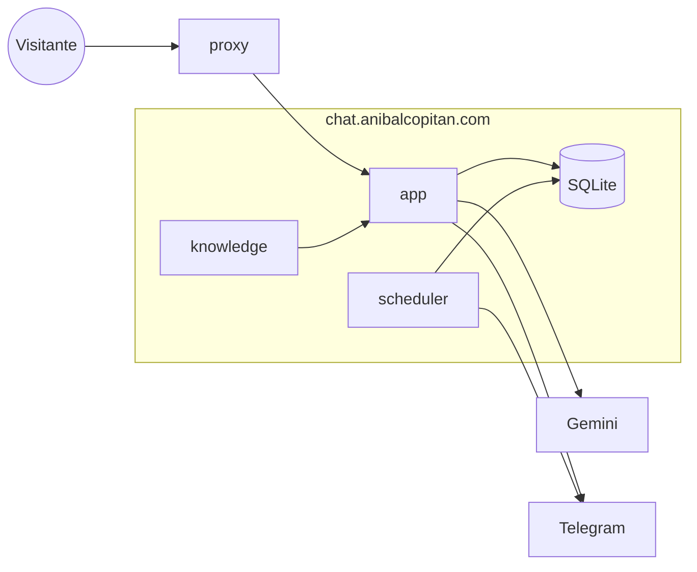
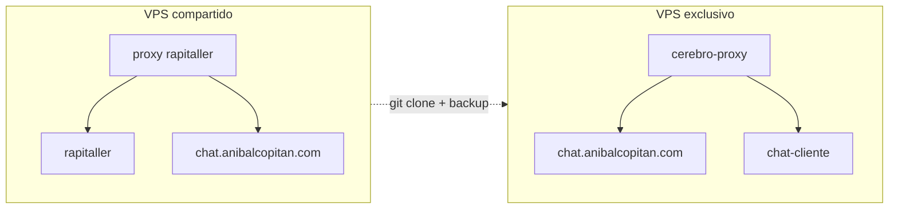

# Arquitectura de Cerebro OS

Cómo funciona por dentro. Para levantarlo y desplegarlo: `README.md`.

## 1. Vista general



Una instancia = un cliente: sus contenedores, su base SQLite y su conocimiento. Nada se comparte entre instancias salvo el proxy (la puerta de entrada).

## 2. Contenedores

| Contenedor | Imagen | Orden | Red | Puertos | Volúmenes |
|---|---|---|---|---|---|
| `chat.anibalcopitan.com` (app) | `cerebro-os` (dev / prod) | `frankenphp run` → servidor web | propia + `red` | ninguno en prod (80 en local) | `./laravel` → `/app`, `./knowledge` → `/app/knowledge` (solo lectura) |
| `chat.anibalcopitan.com-scheduler` | la misma | `php artisan schedule:work` → reloj | solo la propia | ninguno | `./laravel` → `/app` |
| `nginx_proxy` / `cerebro-proxy` | `nginxproxy/nginx-proxy` + `acme-companion` | proxy + HTTPS | `red` | 80, 443 | `docker.sock` (solo lectura), certificados |

- **Imagen** (`common/frankenphp/Dockerfile`): PHP 8.4 + Caddy (FrankenPHP). No contiene el código: el código se monta desde `./laravel`.
  - `dev`: tal cual.
  - `prod`: `php.ini` de producción.
- **Arranque** (`common/frankenphp/entrypoint.sh`, solo `app`): `composer install` (en prod `--no-dev`) → `.env` → SQLite → `migrate` → `knowledge:sync` → en prod `optimize`.
- **app y scheduler son el mismo Laravel**: misma imagen, misma carpeta, mismo archivo SQLite. Solo cambia la orden de arranque. Un proceso por contenedor: si uno falla, el otro sigue.
- **Proxy**: detecta la app por `VIRTUAL_HOST` y saca el certificado con `LETSENCRYPT_HOST`. En el VPS compartido se usa el de rapitaller; en uno propio, `common/proxy`.

## 3. Scheduler

```
Docker mantiene vivo → php artisan schedule:work
                         └─ cada minuto → schedule:run
                                            └─ ejecuta las tareas de routes/console.php que tocan
```

| Cuándo (hora Lima) | Comando | Archivo | Qué hace |
|---|---|---|---|
| Cada minuto | `calls:remind` | `app/Console/Commands/CallsRemind.php` | Llamadas pendientes cuya franja empieza en ≤ 5 min → un aviso a Telegram. Marca `reminded_at` solo si Telegram respondió (si falla, reintenta el minuto siguiente). `withoutOverlapping` |
| 3:00 am | `db:backup` | `app/Console/Commands/DbBackup.php` | `VACUUM INTO` → `storage/app/backups/database-*.sqlite`. Guarda 14 copias |
| 3:30 am | `data:prune` | `app/Console/Commands/DataPrune.php` | Borra llamadas > 90 días y conversaciones sin actividad > 180 días (Ley 29733) |

- **Agregar una tarea:** crear el comando y añadir una línea en `routes/console.php`. Docker no cambia.
- **Revisar:** `docker compose exec app php artisan schedule:list` · `docker compose logs -f scheduler`.
- **Sin Docker**, lo mismo se hace con cron: `* * * * * php artisan schedule:run`.

## 4. Flujo de una petición (chat)

```
widget.js ──POST /api/chat──▶ proxy ──▶ app
                                        ├─ throttle:chat (IP real vía CEREBRO_TRUSTED_PROXIES)
                                        ├─ guarda el mensaje (conversations, messages)
                                        ├─ system prompt = resources/prompts/sistema.md + conocimiento compilado
                                        ├─ Prism → Gemini (modelo principal → respaldo si falla)
                                        └─ responde en streaming (SSE) y guarda la respuesta
```

| Endpoint | Para qué | Protección |
|---|---|---|
| `GET /api/widget` | Configuración del widget (textos, colores, chips) | CORS |
| `POST /api/chat` | Mensaje → respuesta en streaming | CORS, límite por IP (minuto y día) |
| `GET /api/call-slots` | Próximas franjas de llamada | CORS |
| `POST /api/call-request` | Agendar llamada → aviso a Telegram | CORS, límite por IP (día), honeypot |

- **Conocimiento:** `knowledge:sync` junta los `.md` de `knowledge/` en `storage/app/knowledge.md` (~19k tokens). Va completo en cada prompt; no hay RAG.
- **Widget** (`public/widget.js`): JS sin dependencias, en Shadow DOM. Toma la base de su propia URL, así que funciona en un subdominio o en una carpeta.

## 5. Datos

| Tabla | Contenido | Retención |
|---|---|---|
| `conversations` | Sesión del visitante (uuid, IP, página) | 180 días sin actividad |
| `messages` | Mensajes de usuario y asistente | Se borran con su conversación |
| `call_requests` | Nombre, WhatsApp, proyecto, franja (UTC), zona horaria, estado | 90 días |
| `cache`, `jobs`, `sessions`, `users` | Tablas de Laravel (límites por IP, etc.) | — |

- **SQLite** en `laravel/database/database.sqlite`. Backups en `laravel/storage/app/backups/`.
- **Nunca se versionan:** `.env`, la base de datos ni los backups.

## 6. Repo y carpetas

```
~/sites/cerebro-os/app/                  ← repo único (este)
├── common/frankenphp/                   imagen
├── common/proxy/                        proxy propio
└── project/<instancia>/                 una carpeta por cliente
    ├── docker-compose(.prod).yml, .env  cómo se levanta
    ├── laravel/                         ← backend (el producto)
    └── knowledge/                       ← vault de Obsidian (solo lo público)
```

Secretos y datos (`.env`, SQLite, backups, `vendor/`) quedan fuera de git. Antes del primer cliente se separa el producto del repo (Fase 4).

## 7. Despliegue



- Producción no abre puertos propios: todo entra por el proxy de la red `red`.
- Mudarse = clonar el repo, crear los 2 `.env`, restaurar el backup y apuntar el DNS. No cambia ningún archivo del proyecto.
