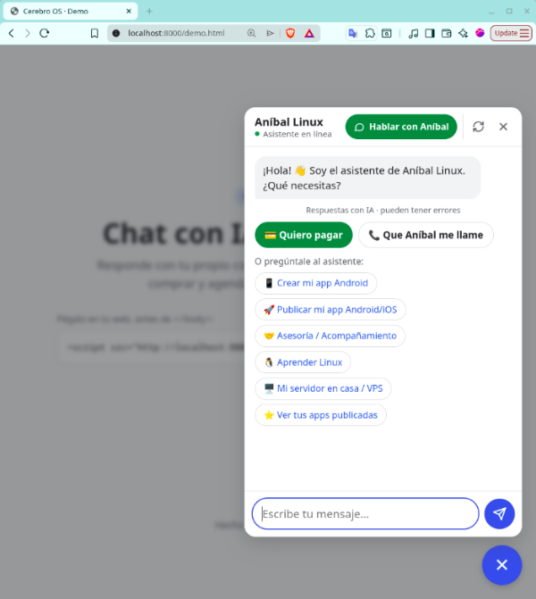

# 🧠 Cerebro OS

**Un solo repo** con todo: Docker, backend y conocimiento. Los secretos y datos (`.env`, SQLite, backups) nunca entran a git.





```
app/                                   ← este repo
├── common/
│   ├── frankenphp/                    ← la imagen: PHP 8.4 + Caddy (targets dev / prod)
│   └── proxy/                         ← nginx-proxy + HTTPS (solo si el VPS no tiene otro proxy)
└── project/
    └── chat.rapitaller.com/        ← una carpeta por instancia (cliente)
        ├── docker-compose.yml         ← local
        ├── docker-compose.prod.yml    ← VPS: sin puertos, se publica por el proxy (red "red")
        ├── .env                       ← Docker: NAME, DOMAIN, EMAIL… (no se versiona)
        ├── laravel/                   ← backend
        │   └── .env                   ← la app: keys de Gemini y Telegram, CORS…
        └── knowledge/                 ← vault de Obsidian de ESTA instancia
```

Dos `.env` distintos: **`.env` de la instancia = Docker**, **`laravel/.env` = la app**.
🔒 **`knowledge/` = solo lo público**: el bot puede revelar cualquier cosa que esté ahí. Notas internas, costos o datos de clientes van fuera (ej. `~/sites/obsidian-vault/cerebro-os`). Ábrelo en Obsidian con "Open folder as vault".
Contenedores con nombre legible (`NAME`): `chat.rapitaller.com` (web) y `chat.rapitaller.com-scheduler` (tareas).

Cómo funciona por dentro (contenedores, scheduler, datos): **`ARQUITECTURA.md`** · Seguridad: **`SEGURIDAD.md`** · Cliente nuevo: **`NUEVA-INSTANCIA.md`** · Variables de los `.env`: **`CONFIGURACION.md`**.

## Local

```bash
cd project/chat.rapitaller.com
cp .env.example .env           # NAME y puerto
docker compose up -d --build   # http://localhost (chat abierto)
docker compose exec app php artisan test
```


## nueva instancias: `chat.rapitaller.com`


importante en .env descomentar:

```
COMPOSE_FILE=docker-compose.prod.yml
```

## GetStart project into docker-compose.yml

```bash
cd chat.rapitaller.com

docker compose down
docker compose up -d
#docker compose up -d --build --force-recreate
```


Dos contenedores con la misma imagen y el mismo código: `app` (web) y `scheduler` (recordatorios, backup diario 3 am y borrado de datos vencidos).

## Producción (manual, con git)

Cerebro **no abre puertos**: se publica a través de un **nginx-proxy en la red `red`** (lo detecta por `VIRTUAL_HOST` y saca el HTTPS con `LETSENCRYPT_HOST`). En el VPS de rapitaller se usa el proxy que ya existe, **sin tocarlo**; en un VPS sin proxy: `cd common/proxy && docker compose up -d`.

**Una sola vez:**
1. DNS: registro `A` del subdominio → IP del VPS. Si pasa por Cloudflare (nube naranja), pon `CEREBRO_TRUSTED_PROXIES=docker,cloudflare` en `laravel/.env`.
2. En el VPS, una **deploy key de solo lectura** para el repo privado:
   ```bash
   ssh-keygen -t ed25519 -f ~/.ssh/cerebro_deploy -N ""   # la .pub va en GitHub → repo → Settings → Deploy keys
   ```
3. Clonar con la misma estructura que en el PC:
   ```bash
   GIT_SSH_COMMAND="ssh -i ~/.ssh/cerebro_deploy -o IdentitiesOnly=yes" git clone git@github.com:USUARIO/cerebro-os.git ~/cerebro-os
   git -C ~/cerebro-os config core.sshCommand "ssh -i ~/.ssh/cerebro_deploy -o IdentitiesOnly=yes"   # para los próximos git pull
   ```
4. Crear los dos `.env` en `~/cerebro-os/project/chat.rapitaller.com/` (`chmod 600`):
   - `.env` → `NAME`, `DOMAIN`, `EMAIL`, `COMPOSE_FILE=docker-compose.prod.yml` (y `UID`/`GID` si no son 1000)
   - `laravel/.env` → desde `laravel/.env.production.example` (keys reales; `APP_KEY`: `echo "base64:$(openssl rand -base64 32)"`)
5. Levantar y comprobar:
   ```bash
   docker ps --filter name=nginx_proxy && docker network ls | grep red   # el proxy existe
   docker compose up -d --build && docker compose logs -f app
   curl -I https://chat.rapitaller.com/up
   ```

**Cada vez (en el VPS, carpeta de la instancia):**

| Cambio | Comando |
|---|---|
| Código (backend) | `git pull && docker compose restart` |
| Docker (imagen o compose) | `git pull && docker compose up -d --build` |
| Conocimiento (Obsidian) | `git pull && docker compose exec app php artisan knowledge:sync` |
| Logs | `docker compose logs -f app` |
| Backup a tu PC | `scp USUARIO@IP:~/cerebro-os/project/chat.rapitaller.com/laravel/storage/app/backups/* ~/sites/cerebro-os/database/` |

Al arrancar, el contenedor corre `composer install`, migraciones y recachea la config: para cambios de código basta `restart`.
Lo único compartido con rapitaller es la puerta de entrada (el proxy). Nunca corras `docker system prune --volumes` en un VPS compartido.

### Mudarse a otro VPS
1. Copiar a tu PC el último backup (`scp` de arriba).
2. En el VPS nuevo: pasos 2–5 (si no tiene proxy, levantar `common/proxy`).
3. `docker compose stop`, copiar el backup a `laravel/database/database.sqlite`, `docker compose start`.
4. Apuntar el DNS a la IP nueva. 🔒 Rota las keys de Gemini y Telegram si el VPS anterior era compartido.

## Nueva instancia

Cada negocio es una carpeta en `project/`, con `laravel/` idéntica en todas. Lo propio va en `.env`, `laravel/.env` (sección Chat) y `knowledge/`. Paso a paso, de los datos del cliente a producción: **`NUEVA-INSTANCIA.md`**.

## Nuevo cliente

Este repo tiene tu conocimiento e historial: **no se entrega a un cliente**. Antes del primero (Fase 4), separa el producto genérico conservando su historial:

```bash
git subtree split --prefix=project/chat.rapitaller.com/laravel -b producto
```
